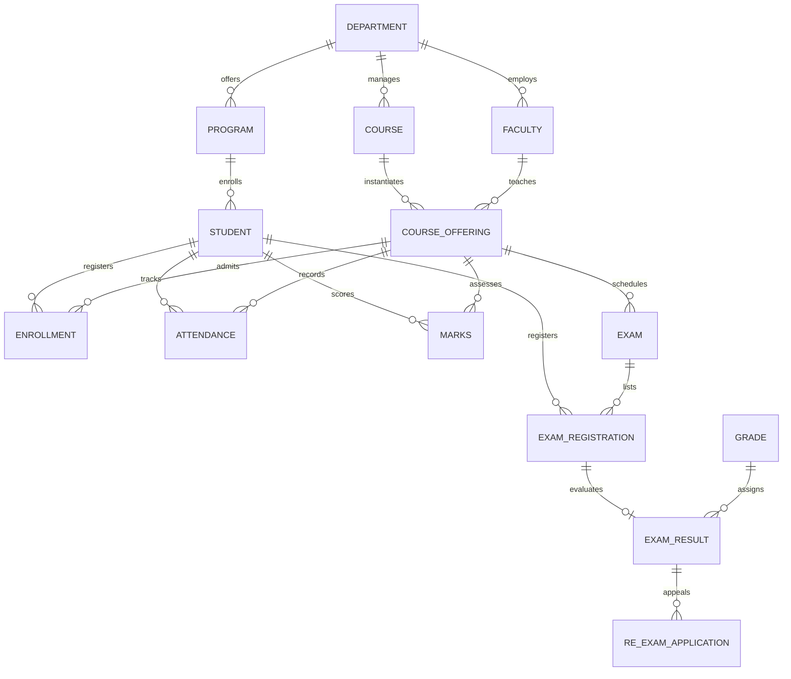

# Smart Campus Management System — Database Systems Project Report

**Course**: Database Systems (CAT-2 Project)  
**Database**: Oracle AI Database 26ai Free (`FREEPDB1`)  
**Backend**: Java 21, Spring Boot 3.3.4, Spring JDBC (`JdbcTemplate`), HikariCP  
**Frontend**: Modern VTOP-Style Responsive Academic Portal (HTML5, CSS3, ES6 JavaScript)  

---

## 1. Executive Summary & Abstract

The **Smart Campus Management System** is a full-stack, enterprise-grade academic portal designed to automate university operations across students, faculty, and administrative departments. Built strictly upon a 14-table relational database schema deployed in Oracle 26ai Free, the system replaces paper-based workflows with automated, constraint-enforced digital workflows.

### Core Objectives:
1. Provide role-tailored academic portals for **Students**, **Faculty**, and **Administrators**.
2. Enforce relational constraints directly in database operations: seat capacity, duplicate enrollment prevention, statutory attendance thresholds (75%), and assessment score boundaries.
3. Deliver a high-performance single-page web interface inspired by premier institutional portals (such as VTOP).
4. Utilize parameterized Prepared Statements and Spring Transactions to guarantee ACID compliance and immunity to SQL injection attacks.

---

## 2. Database Schema & Data Dictionary

The database consists of **14 normalized relational tables** in Oracle AI Database 26ai Free:



### Table Specifications:

| # | Table Name | Primary Key | Foreign Keys | Key Constraints & Checks |
|---|---|---|---|---|
| 1 | `DEPARTMENT` | `Department_ID` | — | `Department_Name` UNIQUE |
| 2 | `PROGRAM` | `Program_ID` | `Department_ID` &rarr; `DEPARTMENT` | `Duration_Years > 0`, `Program_Name` UNIQUE |
| 3 | `STUDENT` | `Student_ID` | `Program_ID` &rarr; `PROGRAM` | `Email` UNIQUE |
| 4 | `FACULTY` | `Faculty_ID` | `Department_ID` &rarr; `DEPARTMENT` | `Email` UNIQUE |
| 5 | `COURSE` | `Course_ID` | `Department_ID` &rarr; `DEPARTMENT` | `Credits > 0` |
| 6 | `COURSE_OFFERING` | `Offering_ID` | `Course_ID` &rarr; `COURSE`<br/>`Faculty_ID` &rarr; `FACULTY` | `Semester BETWEEN 1 AND 10`<br/>`Max_Seats > 0`, `Classes_Held >= 0`<br/>`UQ_OFFERING(Course_ID, Semester, Academic_Year, Section)` |
| 7 | `ENROLLMENT` | `Enrollment_ID` | `Student_ID` &rarr; `STUDENT`<br/>`Offering_ID` &rarr; `COURSE_OFFERING` | `UQ_ENROLLMENT(Student_ID, Offering_ID)` |
| 8 | `ATTENDANCE` | `Attendance_ID` | `Student_ID` &rarr; `STUDENT`<br/>`Offering_ID` &rarr; `COURSE_OFFERING` | `Classes_Attended >= 0`<br/>`UQ_ATTENDANCE(Student_ID, Offering_ID)` |
| 9 | `MARKS` | `Mark_ID` | `Student_ID` &rarr; `STUDENT`<br/>`Offering_ID` &rarr; `COURSE_OFFERING` | `CA >= 0, Midterm >= 0, Final >= 0`<br/>`UQ_MARKS(Student_ID, Offering_ID)` |
| 10 | `GRADE` | `Grade_Code` | — | `Grade_Point BETWEEN 0 AND 10`<br/>`Min_Percentage <= Max_Percentage` |
| 11 | `EXAM` | `Exam_ID` | `Offering_ID` &rarr; `COURSE_OFFERING` | `End_Time > Start_Time`, `Max_Marks > 0` |
| 12 | `EXAM_REGISTRATION` | `Exam_Registration_ID` | `Student_ID` &rarr; `STUDENT`<br/>`Exam_ID` &rarr; `EXAM` | `UQ_EXAMREG(Student_ID, Exam_ID)` |
| 13 | `EXAM_RESULT` | `Exam_Result_ID` | `Exam_Registration_ID` (UNIQUE)<br/>`Grade_Code` &rarr; `GRADE` | `Marks_Obtained >= 0` |
| 14 | `RE_EXAM_APPLICATION` | `ReExam_Application_ID` | `Exam_Result_ID` &rarr; `EXAM_RESULT` | `Status IN ('PENDING', 'APPROVED', 'REJECTED')` |

---

## 3. Relational Normalization Analysis

All 14 tables in the schema comply with **Third Normal Form (3NF)** and **Boyce-Codd Normal Form (BCNF)**:

1. **First Normal Form (1NF)**:
   - All attribute values are atomic (e.g. single email, single date, scalar numbers).
   - No repeating groups or multivalued attributes exist.
2. **Second Normal Form (2NF)**:
   - Every non-prime attribute is fully functionally dependent on the entire candidate key.
   - Surrogate primary keys (`Student_ID`, `Offering_ID`, `Enrollment_ID`, etc.) ensure no partial functional dependencies exist.
3. **Third Normal Form (3NF)**:
   - There are no transitive dependencies among non-key attributes ($X \rightarrow Y$ only where $X$ is a superkey).
   - Foreign keys reference primary tables rather than duplicating transitive metadata (e.g. `STUDENT` references `Program_ID`, which references `Department_ID`, preventing transitive anomalies).
4. **BCNF Compliance**:
   - In composite unique constraints such as `UQ_OFFERING(Course_ID, Semester, Academic_Year, Section)`, the determinant is an explicit candidate key.

---

## 4. Key Business Logic & Database Transactions

### 4.1 Course Enrollment & Seat Capacity Enforcement
When a student registers for a course offering:
```sql
-- 1. Check duplicate enrollment
SELECT COUNT(*) FROM ENROLLMENT WHERE Student_ID = ? AND Offering_ID = ? AND Status = 'ENROLLED';

-- 2. Verify capacity: current enrolled count vs max seats
SELECT COUNT(*) FROM ENROLLMENT WHERE Offering_ID = ? AND Status = 'ENROLLED';
SELECT Max_Seats FROM COURSE_OFFERING WHERE Offering_ID = ?;

-- 3. Atomic registration transaction
INSERT INTO ENROLLMENT (Enrollment_ID, Student_ID, Offering_ID, Enrollment_Date, Status)
VALUES (?, ?, ?, SYSDATE, 'ENROLLED');

-- 4. Initialize dependent tracking records
INSERT INTO ATTENDANCE (Attendance_ID, Student_ID, Offering_ID, Classes_Attended) VALUES (?, ?, ?, 0);
INSERT INTO MARKS (Mark_ID, Student_ID, Offering_ID, Continuous_Assessment_Marks, Midterm_Marks, Final_Exam_Marks) VALUES (?, ?, ?, 0, 0, 0);
```

### 4.2 Attendance Analytics & Statutory Shortage Monitoring
Attendance percentage is calculated as:
$$\text{Attendance Percentage} = \left(\frac{\text{Classes Attended}}{\text{Classes Held}}\right) \times 100\%$$
- If $\text{Percentage} < 75\%$, the portal triggers a **SHORTAGE (< 75%)** warning badge.
- When faculty submits attendance, server-side validation enforces:
$$0 \le \text{Classes Attended} \le \text{Classes Held}$$

### 4.3 GPA / CGPA Calculation
Semester Grade Point Average (GPA) is computed across all graded course offerings:
$$\text{GPA} = \frac{\sum (\text{Credits}_i \times \text{GradePoint}_i)}{\sum \text{Credits}_i}$$
Using the `GRADE` table mapping:
- **S**: 10.0 (90–100%)
- **A**: 9.0 (80–89.99%)
- **B**: 8.0 (70–79.99%)
- **C**: 7.0 (60–69.99%)
- **D**: 6.0 (50–59.99%)
- **F**: 0.0 (0–49.99%)

---

## 5. System Architecture & Tech Stack

```
+-------------------------------------------------------------+
|              CLIENT LAYER: Single-Page Application          |
|      HTML5 | CSS3 (VTOP Navy Theme) | Vanilla JS ES6        |
|  - Student Portal  - Faculty Portal  - Administration Portal|
+------------------------------+------------------------------+
                               | REST / JSON (fetch)
+------------------------------v------------------------------+
|             BACKEND LAYER: Spring Boot 3.3.4 (Java 21)      |
|  - REST Controllers (Auth, Student, Faculty, Admin)         |
|  - Service Layer (Validation, Transaction Management)       |
|  - Repository Layer (Spring JdbcTemplate PreparedStatements)|
|  - Connection Pool: HikariCP (Max 10, Min Idle 2)           |
+------------------------------+------------------------------+
                               | JDBC Thin Driver (ojdbc11)
+------------------------------v------------------------------+
|            DATABASE LAYER: Oracle 26ai Free (Docker)        |
|  - Service: FREEPDB1 | Schema: CAMPUS_APP | 14 Core Tables  |
+-------------------------------------------------------------+
```

---

## 6. Comprehensive REST API Reference

| Endpoint | HTTP Method | Access Role | Description |
|---|:---:|:---:|---|
| `/api/auth/health` | `GET` | Public | Real-time database connection ping |
| `/api/auth/login` | `POST` | Public | Database-backed identity verification |
| `/api/student/{id}/profile` | `GET` | Student | Official student details and program info |
| `/api/student/{id}/enrollments` | `GET` | Student | List of currently registered courses |
| `/api/student/{id}/offerings` | `GET` | Student | Course offerings with live seat counts |
| `/api/student/{id}/enroll` | `POST` | Student | Register for offering (capacity validated) |
| `/api/student/{id}/attendance` | `GET` | Student | Subject attendance and percentage |
| `/api/student/{id}/marks` | `GET` | Student | Internal, midterm, final marks & GPA |
| `/api/student/{id}/exams` | `GET` | Student | Exam timetables and registration |
| `/api/student/{id}/exams/register`| `POST` | Student | Register for examination |
| `/api/student/{id}/results` | `GET` | Student | Published examination results |
| `/api/student/{id}/re-exams` | `GET` | Student | Re-examination application status |
| `/api/student/{id}/re-exams/apply`| `POST`| Student | Submit re-examination petition |
| `/api/faculty/{id}/profile` | `GET` | Faculty | Faculty details and department |
| `/api/faculty/{id}/offerings` | `GET` | Faculty | Assigned course sections |
| `/api/faculty/{id}/offerings/{oid}/students` | `GET` | Faculty | Enrolled roster with marks & attendance |
| `/api/faculty/{id}/offerings/{oid}/classes-held` | `POST` | Faculty | Update total classes conducted |
| `/api/faculty/{id}/attendance` | `POST` | Faculty | Enter student attendance record |
| `/api/faculty/{id}/marks` | `POST` | Faculty | Enter CA, Midterm, and Final marks |
| `/api/faculty/{id}/exams` | `GET` | Faculty | Exam schedule for assigned offerings |
| `/api/admin/stats` | `GET` | Admin | High-level campus metrics overview |
| `/api/admin/departments` | `GET/POST`| Admin | List and create academic departments |
| `/api/admin/programs` | `GET/POST`| Admin | List and create degree programs |
| `/api/admin/students` | `GET/POST`| Admin | List and register students |
| `/api/admin/faculty` | `GET/POST`| Admin | List and add faculty members |
| `/api/admin/courses` | `GET/POST`| Admin | List and add master courses |
| `/api/admin/offerings` | `GET/POST`| Admin | Schedule course offerings with faculty |
| `/api/admin/exams` | `GET/POST`| Admin | Publish examination schedules |
| `/api/admin/results` | `GET` | Admin | Master view of all published results |
| `/api/admin/re-exams` | `GET` | Admin | In-queue re-exam applications |
| `/api/admin/re-exams/decision` | `POST` | Admin | Approve or Reject re-exam petitions |

---

## 7. How to Run the Project

### One-Click Launch (Windows):
Double-click `run.bat` in the workspace root or execute:
```powershell
.\run.ps1
```
The script will verify Docker, set up credentials, start the Spring Boot web server, and open `http://localhost:8080/` in your browser.

### Manual Launch:
```powershell
cd SmartCampus
$env:CAMPUS_DB_PASSWORD = "<your-db-password>"   # or set it once: setx CAMPUS_DB_PASSWORD "<your-db-password>"
.\mvnw.cmd spring-boot:run
# or: java -jar target\smart-campus-1.0.0.jar
```

---

## 8. Database Systems Viva Voce Questions & Answers

**Q1: Why did you choose Prepared Statements over Statement in JDBC?**  
*Answer*: Prepared Statements are pre-compiled by the database engine, providing faster execution on repeated queries and parameterized inputs that eliminate SQL Injection vulnerabilities.

**Q2: How does the application prevent duplicate course registration?**  
*Answer*: At the database level, the composite constraint `UQ_ENROLLMENT(Student_ID, Offering_ID)` prevents duplicate rows. In addition, the Spring service layer queries the database before insertion and raises a conflict exception if the student is already registered.

**Q3: How are ACID properties guaranteed during enrollment?**  
*Answer*: Spring's `@Transactional` annotation ensures that inserting into `ENROLLMENT`, initializing `ATTENDANCE` (0), and initializing `MARKS` (0) occur inside a single database transaction. If any statement fails, the entire transaction rolls back to preserve consistency.

**Q4: How are primary keys generated without Oracle sequences?**  
*Answer*: The repository layer executes atomic `SELECT NVL(MAX(ID), base) + 1 FROM Table` queries within the transaction context, maintaining full compatibility with the existing schema without requiring DDL alterations.

**Q5: What is the purpose of connection pooling (HikariCP)?**  
*Answer*: Creating new physical database connections is computationally expensive (TCP handshake, process spawning, authentication). HikariCP maintains a pool of pre-warmed connections (`maximum-pool-size: 10`, `minimum-idle: 2`), drastically reducing response latency.
